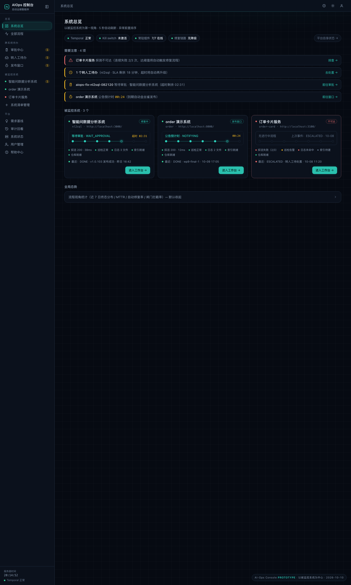
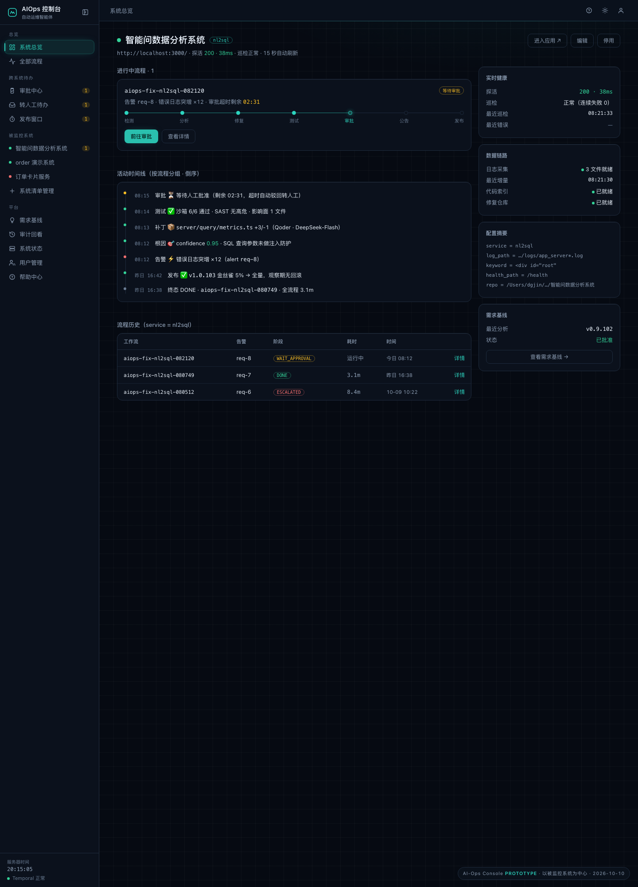
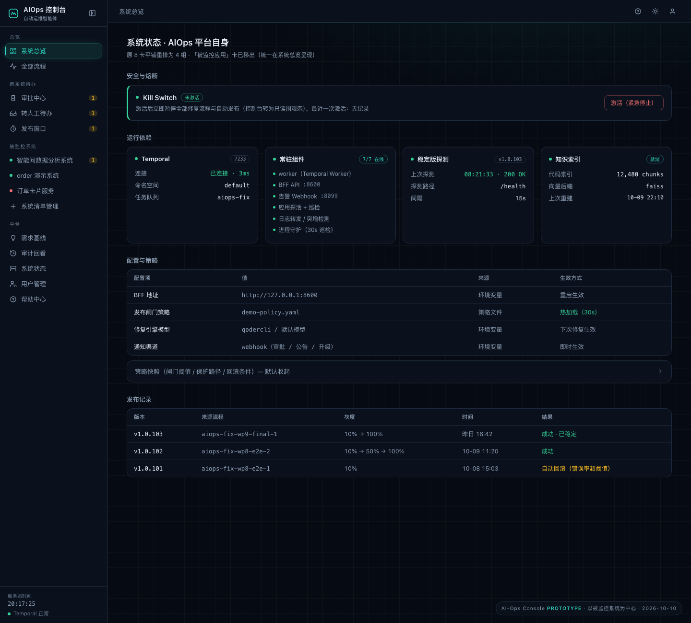

# 控制台 UI 重构设计方案：以「被监控系统」为第一视角

> 2026-10-10 · 状态：待批准 · 配套原型：`prototype.html`（浏览器直接打开）

---

## 一、现状诊断（以被监控系统视角审查）

系统里最重要的对象是「被监控系统」（MonitoredApp），但在现有控制台中它只是二等公民：

| # | 问题 | 证据 |
|---|------|------|
| P1 | **首页是「流程看板」**——6 个计数卡（运行中/待审批/倒计时/今日完成/转人工/失败）与流程卡墙全部是「流程」态，看不到「我有几个被监控系统、各自健康度如何」 | `Dashboard.tsx` |
| P2 | **「被监控应用」是维护表格页**——852 行里绝大多数是 CRUD/导入导出/批量操作；探测/巡检/就绪度（repo/index/log）挤在表格小字里，与流程、告警完全割裂 | `MonitoredApps.tsx` |
| P3 | **同一系统的信息散落 4+ 个页面**——健康在「被监控应用」、流程在「看板/流程列表」、待办在「审批中心/转人工」、配置在「系统状态」；不存在「以一个系统为主语」的视图 | 全站 |
| P4 | **「系统状态」页是 8 卡平铺拼盘**——Kill switch / Temporal / 稳定版 / 被监控应用 / 配置项 / 策略快照 / 知识索引 / 最近发布混在一起；「平台自身」与「被监控对象」混排，层级不清 | `SystemPage.tsx` |
| P5 | **导航 11 项功能平铺、无分组**——用户要回答「nl2sql 系统现在怎么样」，需跨 5 个页面拼图 | `AppShell.tsx` |

**数据层已就绪（关键利好）**：
- `AlertMeta.service` ↔ `MonitoredApp.service` 是现成的关联键；
- `GET /api/flows?service=X` 已支持按系统过滤（`bff/routes/flows.py:107`）；
- `GET /api/requirements/analyses?app_id=` 已支持按系统过滤；
- `MonitoredApp` 已带 `probe` / `watcher` / `readiness` 三组实时状态。

→ **重构主要是前端信息架构重组，几乎不需要新后端能力。**

---

## 二、设计目标与原则

1. **主语切换**：以「被监控系统」为第一级对象；流程、告警、审批、发布降为挂在系统之下的「事件」。
2. **三级钻取**：系统总览（所有系统）→ 系统工作台（单系统）→ 流程详情（单事件）。
3. **异常前置**：健康差、有待办的系统永远排最前（「需要注意」区）。
4. **复用不重建**：StageBadge / FlowCard / EventTimeline / PermissionGate / 双主题 token / 侧栏收缩等既有资产全部保留；数据全部来自现有 API。
5. **不破坏现网约束**：权限门控与 `bff/middleware.py` 同源；倒计时仍走 BFF `server_time` 校准；深浅主题零硬编码色值。

---

## 三、新信息架构（导航重构：11 项平铺 → 4 组）

```
总览
  ├─ 系统总览 ★新首页（原「流程看板」退役，能力下沉到本页折叠区）
  └─ 全部流程（原「流程列表」，全局检索用）

跨系统待办              [badge 合计]
  ├─ 审批中心           （保留，badge=wait_approval）
  ├─ 转人工待办         （保留，badge=escalations_open）
  └─ 发布窗口           （保留，badge=notifying）

被监控系统
  ├─ ● 智能问数据分析系统    ← /systems/:appId（★新增：系统工作台）
  ├─ ● order 演示系统       ← /systems/:appId
  └─ 系统清单管理           （原「被监控应用」维护页）
       ·  动态系统列表来自 /api/monitored-apps（15s 轮询）；
          每项带健康点（ok/danger/idle）+ 进行中流程数角标

平台
  ├─ 需求基线
  ├─ 审计回看
  ├─ 系统状态（AIOps 平台自身）
  ├─ 用户管理（adminOnly 保持）
  └─ 帮助中心
```

**侧栏动态系统列表**的技术规则：
- 系统数 ≤ 8 直接平铺；超出后该分组内部滚动（保持 224px 侧栏不变）；
- 健康点语义：`enabled=false` → idle 灰；`probe.running` → ok 绿；否则 danger 红（脉冲）；
- 进行中流程数从 `/api/overview` 的 `running[].alert.service` 前端 join（数据量小，零后端改动）。

---

## 四、页面级布局规划

### 4.1 系统总览（新首页 `/`，替代流程看板）

```
┌ 平台健康带（只读 chips，异常变红，点击跳 /system）────────────────┐
│ ● Temporal 正常   ● Kill switch 未激活   ● 组件 7/7   ● 无降级    │
├ 需要注意（动态分区，全部正常时收成一行绿勾）───────────────────────┤
│ ⚠ order-card 探测不可达（连续失败 2/3 次）              → 排查      │
│ ⚠ 1 个转人工待办（nl2sql · SLA 剩 18 分钟）             → 处置      │
│ ⚠ aiops-fix-nl2sql-082120 等待审批（超时 02:31）        → 前往审批  │
│ ⚠ order 公告倒计时 00:24（点「立即发布」）               → 前往窗口  │
├ 系统卡片墙（grid 2~3 列，健康差的排最前）──────────────────────────┤
│ ┌──────────────────────┐ ┌──────────────────────┐                 │
│ │ ● 智能问数据分析系统    │ │ ● order 演示系统       │                │
│ │ nl2sql · :3000        │ │ order · :8000        │                │
│ │ ◉ 修复中 测试阶段 ▓▓▓░ │ │ ○ 无进行中流程         │                │
│ │ 探活● 巡检● 日志● 索引● │ │ 探活● 巡检● 日志● 索引● │                │
│ │ 最近：DONE v1.0.103    │ │ 最近：DONE wp9-final-1 │                │
│ │ [进入工作台 →]         │ │ [进入工作台 →]         │                │
│ └──────────────────────┘ └──────────────────────┘                 │
├ 全局态势（折叠，默认收起；原看板价值保留）─────────────────────────┤
│ 计数卡 ×6 ｜ 近 7 日终态环形 ｜ 运营度量（MTTR/自动修复率/…）        │
└───────────────────────────────────────────────────────────────┘
```

卡片元素明细：
1. 健康点 + 名称 + 备注；
2. URL（mono）+ service chip；
3. **活跃流程带**：有进行中 → mini 阶段管道（当前阶段高亮 + 阶段名 + 若有倒计时则显示）；无 → 「无进行中流程」灰字；
4. **就绪度四联**：探活 / 巡检 / 日志 / 索引 / 仓库（复用 `ReadinessLine` 语义，点状 + 悬浮说明）；
5. 最近事件行（最近一次终态：阶段 + 版本/时间，深链）；
6. 卡脚主按钮「进入工作台 →」。

### 4.2 系统工作台（新增 `/systems/:appId`）★核心新页面

```
┌ 页头（粘性）────────────────────────────────────────────────────┐
│ ● 智能问数据分析系统  [nl2sql]               [进入应用][编辑][停用] │
│ http://localhost:3000/ · 15 秒自动刷新 ← 探活 200·38ms · 巡检正常  │
├ 主区（8 列）──────────────────┬ 侧区（4 列）───────────────────────┤
│ 【进行中流程】                │ 【实时健康】                       │
│ aiops-fix-nl2sql-082120      │ 探活 200 · 38ms · 08:21:33         │
│ WAIT_APPROVAL · 审批 02:31    │ 巡检 正常（连续失败 0）             │
│ 检测✓ 分析✓ 修复✓ 测试✓ 审批● │ 最近错误 —                          │
│                              │ 【数据链路】                        │
│ 【活动时间线】                │ 日志 3 文件就绪 · 08:21:30 增量      │
│ 08:12 告警 错误日志突增 ×12    │ 索引 就绪 · 仓库 就绪               │
│ 08:12 根因 confidence 0.95    │ 【配置摘要】                        │
│ 08:13 补丁 +3/-1（1 文件）    │ service / log_path / probe_keyword │
│ 08:14 测试 6/6 通过           │ / health_path / repo               │
│ 08:15 审批 ⏳ 等待中           │ 【需求基线】                        │
│ （按 wf 分组折叠，深链详情）    │ 最近分析 v0.9.102 · 已批准          │
│ 【流程历史表】                │                                    │
│ wf_id ｜告警｜阶段｜耗时｜详情  │                                    │
└──────────────────────────────┴───────────────────────────────────┘
```

### 4.3 平台系统状态（`/system` 重排：拼盘 → 4 组）

```
1. 安全与熔断   Kill Switch（状态 + 激活/关闭操作，保持原地）
2. 运行依赖     Temporal ｜ 常驻组件 7 项（api.subsystems）｜ 稳定版探测 ｜ 知识索引
3. 配置与策略   配置项表（来源/生效方式，保持）+ 策略快照（折叠）
4. 发布记录     最近发布
（移除「被监控应用」卡 → 消除与系统总览重复，指向系统清单管理）
```

---

## 五、数据映射（新布局 ↔ 现有 API，零缺口）

| 新界面元素 | 数据来源 | 改动 |
|-----------|---------|------|
| 侧栏系统列表 + 健康点 | `GET /api/monitored-apps`（probe/watcher） | 无 |
| 侧栏/卡片进行中流程数 | `GET /api/overview`（running[].alert.service join） | 无 |
| 系统总览卡片墙 | 同上两条 join | 无 |
| 需要注意（探测/巡检） | `monitored-apps`（probe.running / watcher.alerted） | 无 |
| 需要注意（审批/窗口/转人工） | `overview.counts` + `/api/escalations` | 无 |
| 工作台进行中/历史流程 | `GET /api/flows?service=X`（已支持过滤） | 无 |
| 工作台活动时间线 | `/api/flows?service=X` + 各流程 `status/result`（渐进加载） | 无（Phase 2 可加聚合端点） |
| 工作台健康/链路/配置 | `monitored-apps` 单条（probe/watcher/readiness） | 无 |
| 需求基线卡 | `GET /api/requirements/analyses?app_id=`（已支持） | 无 |
| 平台健康带 | `/api/health` + `/api/system` + `/api/subsystems` | 无 |

仅 Phase 2 可选增强：`GET /api/systems/overview` 聚合端点（当系统数或流程数增长到 N+1 轮询明显时）。

---

## 六、实施计划（分两期）

**Phase 1 · 纯前端（本次批准后执行）**
1. `AppShell.tsx`：导航分组（总览/跨系统待办/被监控系统/平台）+ 动态系统列表；
2. 新增 `pages/SystemOverview.tsx`（新首页：健康带 + 需要注意 + 卡片墙 + 折叠的全局态势）；
3. 新增 `pages/SystemWorkbench.tsx`（`/systems/:appId` 工作台）；
4. `SystemPage.tsx`：8 卡平铺 → 4 组分区；
5. `MonitoredApps.tsx`：表格行加「工作台」入口（保留全部维护能力）；
6. `App.tsx` 路由：`/` 换新首页、新增 `/systems/:appId`、原看板能力并入折叠区；
7. `npm run build` + 关键路径浏览器截图验收（总览/工作台/状态页 × 双主题抽检）。

**Phase 2 · 可选增强（另行批准）**
- BFF `/api/systems/overview` 聚合端点；
- 未纳管服务检测（alert.service 不在清单 → 总览提示）；
- 工作台时间线服务端聚合（减少渐进请求）。

---

## 七、验收标准

- [ ] 首页 5 秒内可回答：「有几个系统？谁不健康？我现在要处理什么？」
- [ ] 任一系统 1 次点击进入工作台，一屏内看到：健康 + 进行中流程 + 最近事件 + 链路就绪；
- [ ] 原三大能力（审批/发布窗口/转人工）在新导航下 1 次点击可达，功能零回归；
- [ ] 深浅主题、侧栏收缩、权限门控（admin 隐藏项）行为不变；
- [ ] 全量前端构建通过，既有测试不受影响（纯前端改动不动 pytest 基线）。

---

## 八、原型预览（`prototype.html` 截图）

| 屏幕 | 预览 |
|------|------|
| 屏 1 · 系统总览（新首页 `/`） |  |
| 屏 2 · 系统工作台（`/systems/:appId`） |  |
| 屏 3 · 平台系统状态（`/system` 重排） |  |

> 原型为单文件 HTML（设计 token 1:1 复刻 `web/src/styles.css` 深色档），浏览器直接打开即可交互：
> 侧栏点击切换 3 屏、点击折叠条展开「全局态势 / 策略快照」、服务器时钟实时走秒。
