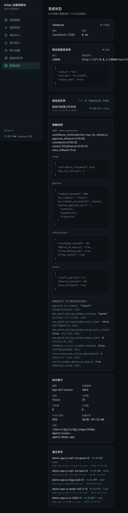
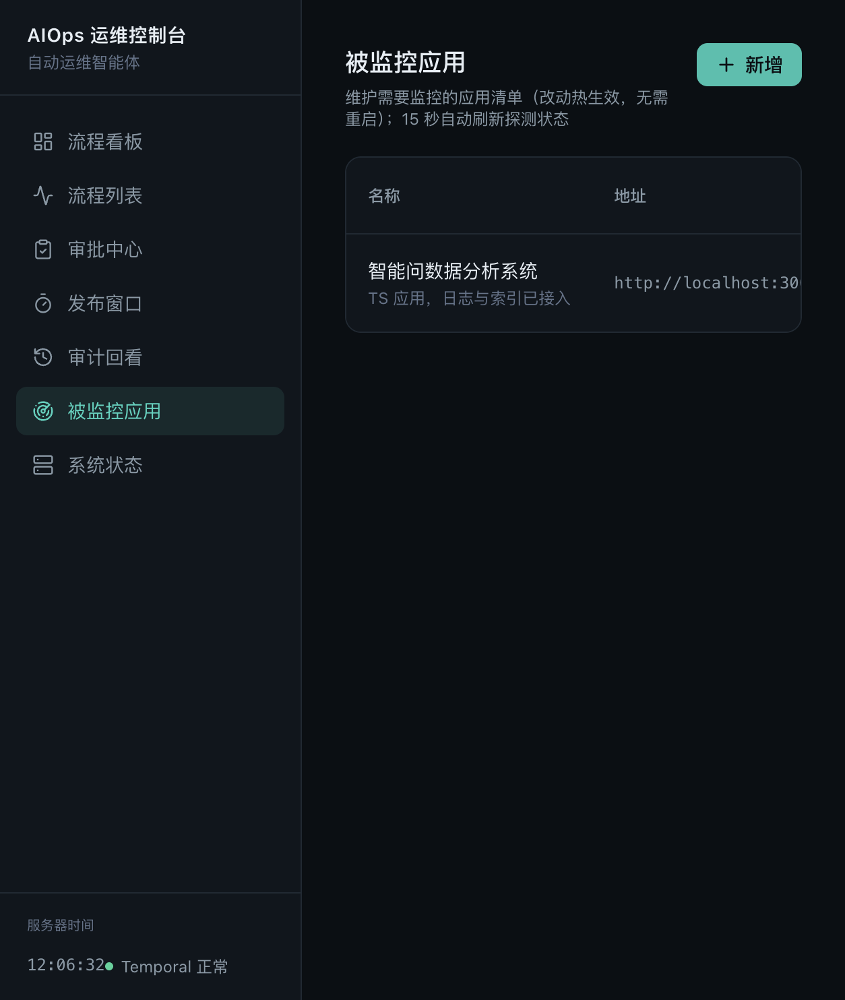
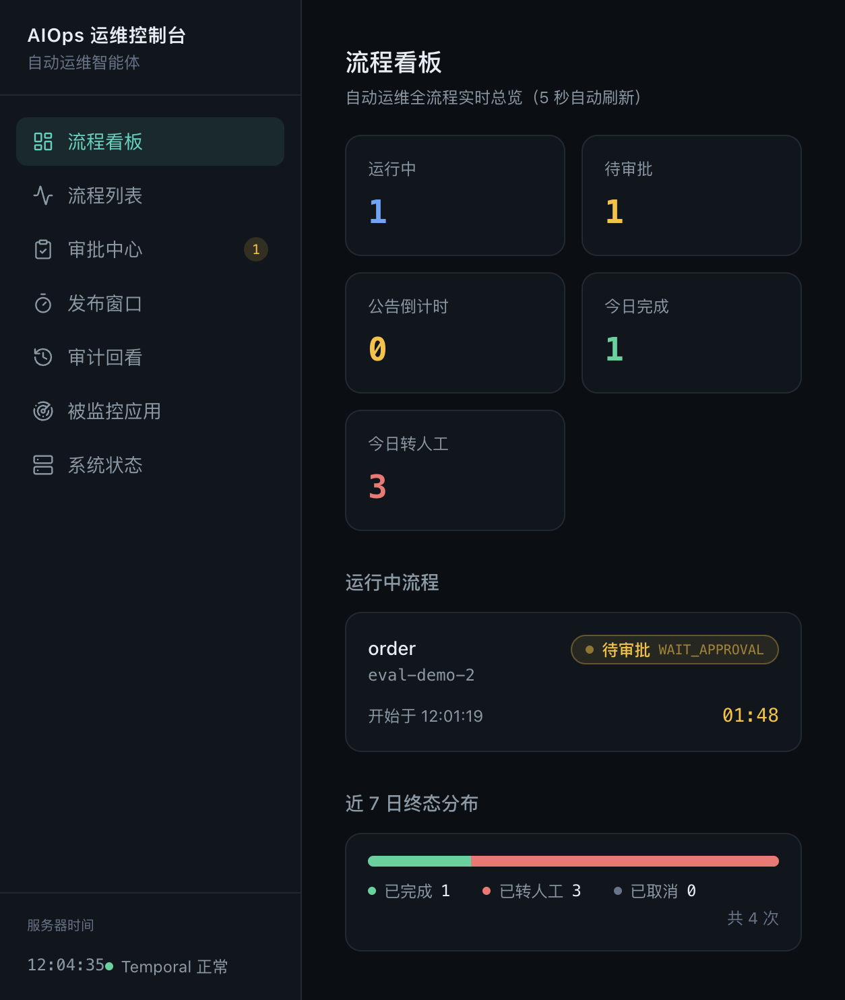
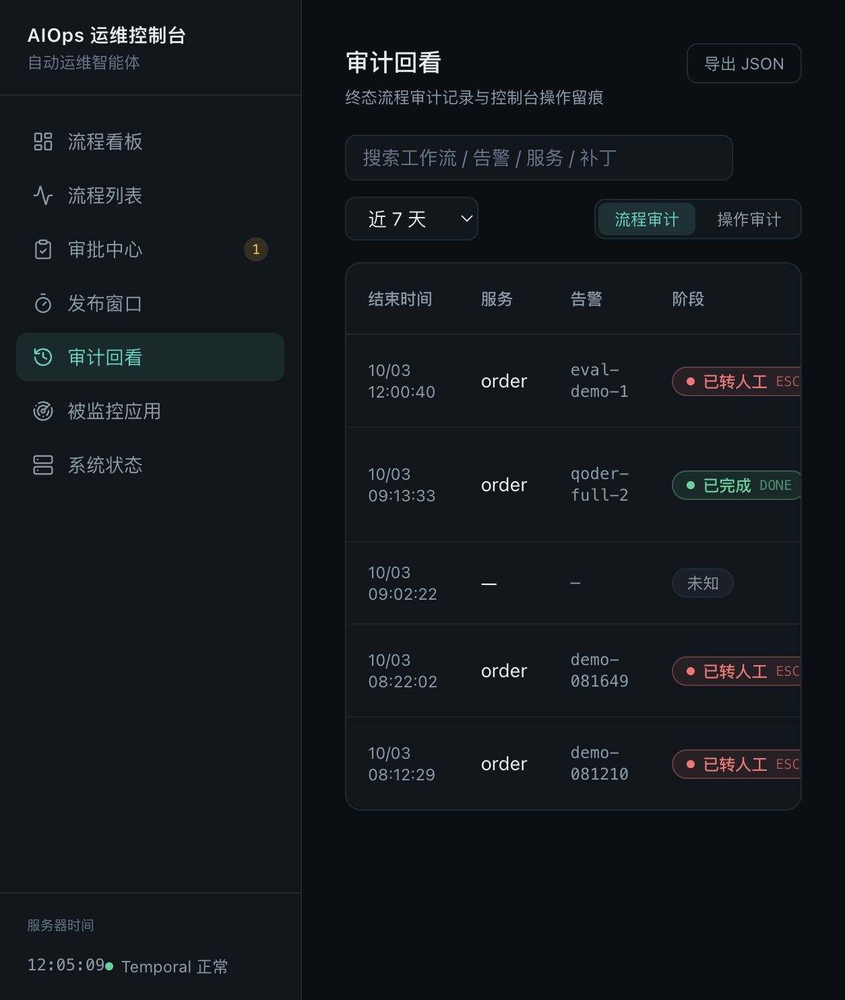
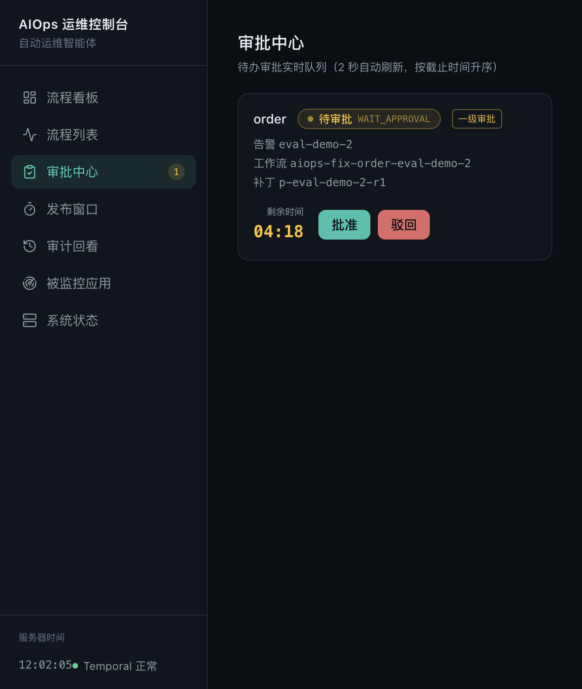
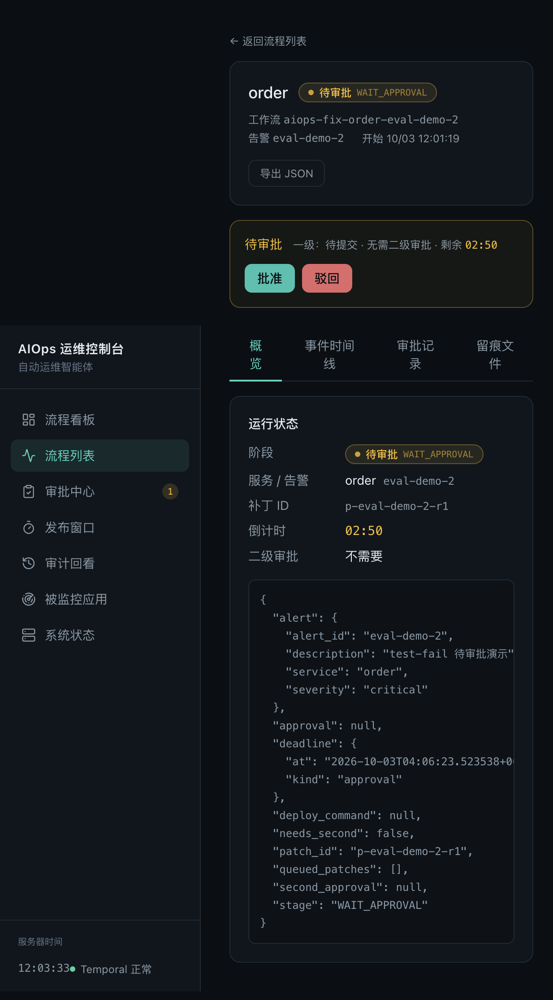

# AIOps 自动运维控制台 — 易用性 / 可用性评估报告

| 项 | 内容 |
| --- | --- |
| 报告版本 | v1.0 |
| 日期 | 2026-10-03 |
| 评估对象 | AIOps 运维控制台（`bff/app.py` + `web/dist`），`http://127.0.0.1:8600` |
| 评估视角 | 运维工程师视角：**通过前台完成配置、跟踪、管理** |
| 核心结论 | **配置面过窄 + 审批决策点信息不足 + 无操作身份**；深度流程的证据沉淀做得扎实 |
| 建议状态 | **未执行**（见 §6），本报告只评估不改动 |
| 证据目录 | [`./evidence/`](./evidence/)（截图 + 接口原始返回 + 代码片段） |

---

## 0. 方法与证据说明

**方法**：实际启动控制台逐页走查（流程看板 / 流程列表 / 审批中心 / 发布窗口 / 审计回看 / 被监控应用 / 系统状态），并对 BFF 的 8 个写接口、审计实现、审批交互做**代码与实测交叉核验**。每条结论均标注证据文件。

**证据类型**：

| 类型 | 说明 | 位置 |
| --- | --- | --- |
| 截图 | 控制台页面实拍 | `evidence/*.png` |
| 接口原始返回 | `curl` 实际响应 | `evidence/api-*.txt` |
| 代码片段 | 带行号的源码摘录 | `evidence/code-*.txt` |

**诚实声明（重要）**：

1. **未点击「批准 / 驳回」的提交按钮**。取证时安全策略拦截了对审批按钮的自动点击，我尊重该拦截、未绕过。因此"审批确认框内有什么"以**代码为证**（`evidence/code-b4-approval-dialog.txt`），并以列表页截图佐证"列表行缺什么"。
2. 为取得"待审批"状态，评测期间临时发起了一个演练流程（`test-fail` 分支，不触发 Qoder），**仅在待审批状态截图**；其后按锁定策略**自动超时驳回**（终态 `ESCALATED`），**未产生任何发布**。
3. 本报告**未改动任何代码/配置**。

---

## 1. 结论摘要

| 维度 | 评级 | 一句话结论 |
| --- | --- | --- |
| **配置管理** | ⚠️ **弱** | 控制台只能维护「被监控应用」1 项；其余配置散在 `.env`/YAML，须改文件+重启，且**不告知生效方式** |
| **跟踪管理** | ⚠️ **中** | 单流程证据链完整可用；但**审计无身份**、配置类审计链接是坏链、**失败流程"消失"** |
| **可用性（安全）** | ❌ **差** | BFF **完全无鉴权**，8 个写接口（含批准发布）裸奔 |
| **可用性（运行）** | ⚠️ **中** | 无降级提示；靠轮询；倒计时服务端校准（做对了） |
| **深度证据沉淀** | ✅ **好** | 根因/补丁/测试报告/发布结果/审批记录/留痕 + 事件时间线，比多数自研控制台完整 |

---

## 2. 配置管理（短板最集中）

### A1｜配置面只打通约 1/4 — 证据 `code-a1-config-surface.txt`

BFF 全部写接口只有两组：**流程操作**（审批/发布指令/排队）与**被监控应用 CRUD**。其余配置域**没有任何写入口**：

| 配置域 | UI 可维护 | 实际生效方式 |
| --- | --- | --- |
| 被监控应用清单 | ✅ 完整 CRUD | **热生效** |
| 闸门策略（审批超时/倒计时/金丝雀/受保护目录） | ❌ 只读 | 改 YAML + 重启；**运行中流程用启动快照，改了也不生效** |
| 修复提供者 / 模型（Qoder、DeepSeek-Flash） | ❌ | 改 env + 重启 worker |
| 沙箱镜像、通知 provider、稳定版容器/端口、索引路径 | ❌ | 改 env + 重启 |

证据（`GET /api/system` 实际返回，原始文件 [`api-a1-system-config.txt`](evidence/api-a1-system-config.txt)）：

```json
{
  "policy_source": "demo-policy.yaml",                    // 只说"从哪加载"，无修改入口
  "policy_summary": "confidence_threshold=0.8, max_fix_retries=2, approval_timeout=0:05:00, countdown=0:00:30, canary=5%/observe=0:00:10, auto_rollback=True",
  "lock_keys": [                                          // 8 项锁定，只读
    "approval.on_timeout", "new_patch_during_window.strategy",
    "new_patch_during_window.reset_timer", "new_patch_during_window.merge_with_current",
    "new_patch_during_window.queue_limit", "feedback_circuit_breaker.enabled",
    "concurrency.max_active_deployments", "notify_window.deploy_on_expiry"
  ],
  "monitored_apps": [                                     // ← 唯一可在 UI 维护的配置
    { "id": "app-d42214", "name": "智能问数据分析系统", "service": "nl2sql",
      "log_path": "/Users/dgjin/dgjinapp/智能问数据分析系统/logs/app_server*.log", "enabled": true }
  ]
}
```

界面同样只读，且**没有任何"生效方式"标注**（改策略需重启、对运行中流程无效，UI 未告知）：



### A2｜生效方式不一致，且 UI 从不告知

被监控应用改完立刻生效；闸门策略改完须重启、且对运行中的流程无效。UI 上**没有"需重启 / 对运行中流程不生效"的标注**——运维极易误判"改了就生效"。

### A3｜配置无版本 / 差异 / 回滚

审计只记动作与新值，**没有 `before → after`**。见 `api-b2-audit-ops.txt`：`monitored-app:update` 仅记新值（name/url/enabled），无法回答"原来是什么"。配置回滚只能手工。

> **附带发现**：配置类审计的 `result` 恒为 `"signaled"`（`write_audit` 的默认值），对配置操作语义不通——没有任何"信号"被发出。

### A4｜清单缺批量与导入导出

只能逐条增删改。审计页有「导出 JSON」，**配置页没有**。见截图：



### A5｜校验只在提交后

地址必须带 scheme、名称唯一，均为服务端 400；弹窗只在底部显示一行错误，**无字段级定位、无实时校验**。

---

## 3. 跟踪管理

### B1｜审计行「目标」链接是坏的 — 证据 `api-b1-404.json.txt` + `code-b1-audit-wfid.txt`

配置类审计把**应用 id 写进了 `wf_id` 字段**（根因见代码证据），前端据此渲染成 `/flows/{id}`。实测：

```
$ curl http://127.0.0.1:8600/api/flows/app-d42214
HTTP 404
{"error":"workflow 不存在: app-d42214"}

$ curl http://127.0.0.1:8600/api/flows/aiops-fix-order-qoder-full-2   # 对照：真实工作流
HTTP 200
```

原始数据（`api-b2-audit-ops.txt`）可见 `"wf_id": "nl2sql"`、`"wf_id": "app-d42214"` —— 都不是工作流。**运维点进去是死路。**

### B2｜审计没有操作身份 — 证据 `api-b2-audit-ops.txt`

所有记录 `actor` 恒为写死的 `"web-console"`：

```json
{"ts":"2026-10-03T03:39:41Z","actor":"web-console","action":"monitored-app:update","wf_id":"app-d42214",
 "params":{"name":"智能问数据分析系统","url":"http://localhost:3000/","enabled":true},"result":"signaled"}
```

叠加 **BFF 完全无鉴权**（见 C1），**"谁批准了发布、谁改了配置"无法追溯**。对一个「经审核确认后才发布生产」的系统，这是硬伤而非打磨项。

### B3｜失败流程在跟踪上"消失" — 证据 `api-b3-failed-flow.txt` + `04-dashboard.png` + `05-audit-flow-tab.png`

活动重试耗尽的硬失败流程，原始返回：

```json
{"wf_id":"aiops-fix-order-qoder-full-1","exec_status":"FAILED",
 "stage":null,"alert":null,"stage_error":"result 读取失败: Workflow execution failed"}
```

后果：审计页显示 `服务=— / 告警=— / 阶段=未知`；看板的「今日完成 / 今日转人工 / 已取消」也**不含它**——**没有"失败/异常"这个终态分类**，运维看不到"有一条流程挂了"。





### B4｜审批页与判断依据不在同一处（最值得改）— 证据 `code-b4-approval-dialog.txt`

审批确认框的 `detail` **只含 4 项**：工作流、服务、告警、决策。**没有 diff、没有测试报告、没有根因置信度、没有影响文件**。（代码摘录见证据文件；对比之下，IM 审批卡片里 diff 与测试报告都有。）

而这是「批准即发生产」的闸门——**成本最高的决策点，给了最少的信息**，运维必须离开当前页去流程详情里翻。



### B5｜审批列表缺关键列 — 证据 `code-b5-approval-row.txt`

列表行只有 服务 / 阶段 / 级别（一级·二级）/ 告警 / 工作流 / 补丁 / 剩余时间；**缺置信度与测试结论摘要**（讽刺的是审计页反而有置信度列）。

---

## 4. 可用性

### C1｜BFF 完全无鉴权 — 证据 `api-c1-write-endpoints.txt` + `api-c1-noauth.txt`

8 个写接口，**没有任何鉴权装饰器或中间件**：

```
355:@app.post("/api/flows/{wf_id}/approval")        # 批准发布
369:@app.post("/api/flows/{wf_id}/second-approval")
387:@app.post("/api/flows/{wf_id}/deploy-command")   # 立即发布/取消
396:@app.post("/api/flows/{wf_id}/queue-patch")
438:@app.post("/api/monitored-apps")
453:@app.put("/api/monitored-apps/{app_id}")
468:@app.post("/api/monitored-apps/{app_id}/toggle")
484:@app.delete("/api/monitored-apps/{app_id}")
```

实测（未带任何凭证）：

```
$ curl -X POST http://127.0.0.1:8600/api/flows/nonexistent-wf/approval -d '{"decision":"approve"}'
{"error":"workflow 不存在: nonexistent-wf"}      ← 直接进入业务逻辑，而非 401
```

默认绑 `127.0.0.1` 是唯一缓解；一旦按部署习惯改成 `--host 0.0.0.0`，等于把「批准发布生产」开在网上。无 CORS 中间件对跨站 JSON 提交有默认缓解，但**不能当安全边界**。

### C2｜配置类写操作有丢更新风险

`PUT` 为「读-改-写」，两人同时编辑同一条会覆盖。高频的启停已单独提供 `toggle` 接口规避，`PUT` 仍是读改写。

### C3｜轮询而非推送

审批 2s / 看板 5s / 系统状态 15s。倒计时用**服务端时间校准**（这点做对了，见 `lib/api.ts` `serverNow()`），但动作生效有延迟、缺"我的操作已生效"的确定性回执。

### C4｜没有降级横幅

Loki / Ollama / Docker 不可用不会在控制台显性提示——而这些恰恰会让修复链路**静默降级为兜底补丁**。Temporal 断开仅左下角一个小点。

### C5｜窄视口体验一般

表格依赖横向滚动（容器确为 `overflow-x-auto`，可用）；窄屏下按钮/KPI 换行。桌面运维工具，可接受。

---

## 5. 建议（按优先级）

**P0 — 安全与正确性**

1. **给 BFF 加认证**，并把 `actor` 从凭证取真实身份，替换写死的 `web-console`。（结构性改动，建议单独一轮）
2. **修审计目标链接**：配置类审计用独立字段（如 `target`）而非复用 `wf_id`；前端按 action 前缀决定是否可跳转。（**B1 本轮实现引入，修复量最小**）
3. **把「失败/异常」纳入流程终态分类**（看板 + 审计 + 流程列表），让挂掉的流程可见。

**P1 — 把「配置」做成一等公民**

4. 系统状态页逐项标注：当前值 / 来源（YAML·env·清单）/ **生效方式（热 or 需重启）** / 对运行中流程是否生效。
5. **审批确认框内联关键证据**（diff 摘要 + 测试结论 + 置信度 + 影响文件数）+ 「查看完整详情」跳转。
6. 配置变更留痕加 **before/after diff**，支持一键回滚。

**P2 — 易用性打磨**

7. 被监控应用支持 **导入/导出 JSON、批量启停、复制条目**。
8. 表单**实时校验 + 字段级错误**。
9. 增加**降级提示横幅**（Loki/Ollama/Docker/Temporal 异常时提示"修复链路处于降级模式"）。
10. 修 `write_audit` 对配置操作默认 `result="signaled"` 的语义错误。

---

## 6. 做得好的地方（不要改坏）

单流程的证据沉淀是扎实的：`GET /api/flows/{id}/result` 一次返回根因 / 补丁 / 测试报告 / gate_events / 发布结果 / 耗时（完整返回见 [`api-e2e-result.txt`](evidence/api-e2e-result.txt)），详情页有 概览 / 事件时间线 / 审批记录 / 留痕文件 四个视图：

```json
// GET /api/flows/aiops-fix-order-qoder-full-2/result  （节选）
{
  "workflow_id": "aiops-fix-order-qoder-full-2",
  "stage": "DONE",
  "root_cause": { "error_type": "NullPointerException", "confidence": 0.95,
                  "suspect_files": ["order-service/src/main/java/com/example/service/OrderService.java"] },
  "patch_id": "p-qoder-full-2-r0",
  "model_version": "qoder-cli:1.1.65",
  "test_report": { "passed": true, "unit_tests": "6/6 passed", "sast": "无高危模式…" },
  "approvals": [ { "gate": "approval", "decision": "approve" } ],
  "gate_events": [ "tests:passed:attempt=0", "mr:created:!2478", "gate2:approved",
                   "gate3:announced:v1.0.678", "gate3:command:deploy_now",
                   "canary:healthy->full-rollout" ],
  "deploy_result": { "version": "v1.0.678", "rolled_back": false },
  "duration_seconds": 275.53
}
```




其他做对的点：服务端时间校准与倒计时；审批重复提交拦截（`_extra` 校验）；写操作一律留痕；被监控应用"读盘不缓存"的热生效实现干净；空状态文案齐备；超时自动驳回的锁定策略按预期生效（本次取证中的待审批流程即自动转人工）。

**问题不在"有没有"，而在"配置面太窄 + 审批点信息太少 + 无身份"。**

---

## 7. 明确未执行的动作

- 未修改任何源码 / 配置 / 前端（评估轮零代码改动，已用文件时间戳核验）。
- 未给 BFF 增加鉴权、未重修审计字段、未调整终态分类。
- 未改动审批页、未增加配置生效方式标注、未做清单导入导出。
- **未点击**审批提交按钮（被安全策略拦截后未绕过）。
- 未产生任何发布：取证用的演练流程在待审批状态截图后，按锁定策略自动超时驳回。

---

## 附录：证据文件清单

### 截图（6）

| 文件 | 对应结论 |
| --- | --- |
| [02-approvals-list.png](evidence/02-approvals-list.png) | B4 / B5（审批列表与确认框缺证据） |
| [03-flow-detail.png](evidence/03-flow-detail.png) | §6 正面（流程详情证据链与多视图） |
| [04-dashboard.png](evidence/04-dashboard.png) | B3（看板无"失败"分类） |
| [05-audit-flow-tab.png](evidence/05-audit-flow-tab.png) | B3（失败流程显示 未知） |
| [06-monitored-apps.png](evidence/06-monitored-apps.png) | A1 / A4（唯一可维护的配置页） |
| [07-system.png](evidence/07-system.png) | A1 / A2（策略只读、无生效方式标注） |

### 接口原始返回（8）

| 文件 | 对应结论 |
| --- | --- |
| [api-b1-404.json.txt](evidence/api-b1-404.json.txt) | B1（坏链实测 404） |
| [api-b1-control.txt](evidence/api-b1-control.txt) | B1 对照（真实工作流 200） |
| [api-b2-audit-ops.txt](evidence/api-b2-audit-ops.txt) | B1 / B2（wf_id 错位、actor 恒为 web-console） |
| [api-b3-failed-flow.txt](evidence/api-b3-failed-flow.txt) | B3（FAILED + stage/alert 为 null） |
| [api-a1-system-config.txt](evidence/api-a1-system-config.txt) | A1（策略只读摘要 + 锁定项 + 清单） |
| [api-c1-write-endpoints.txt](evidence/api-c1-write-endpoints.txt) | C1（写接口清单 + 无鉴权） |
| [api-c1-noauth.txt](evidence/api-c1-noauth.txt) | C1（无凭证直达业务逻辑） |
| [api-e2e-result.txt](evidence/api-e2e-result.txt) | §6 正面（完整证据链返回） |

### 代码片段（4）

| 文件 | 对应结论 |
| --- | --- |
| [code-a1-config-surface.txt](evidence/code-a1-config-surface.txt) | A1（全部路由） |
| [code-b1-audit-wfid.txt](evidence/code-b1-audit-wfid.txt) | B1 根因（应用 id 写进 wf_id） |
| [code-b4-approval-dialog.txt](evidence/code-b4-approval-dialog.txt) | B4（确认框 detail 字段） |
| [code-b5-approval-row.txt](evidence/code-b5-approval-row.txt) | B5（列表行字段） |
